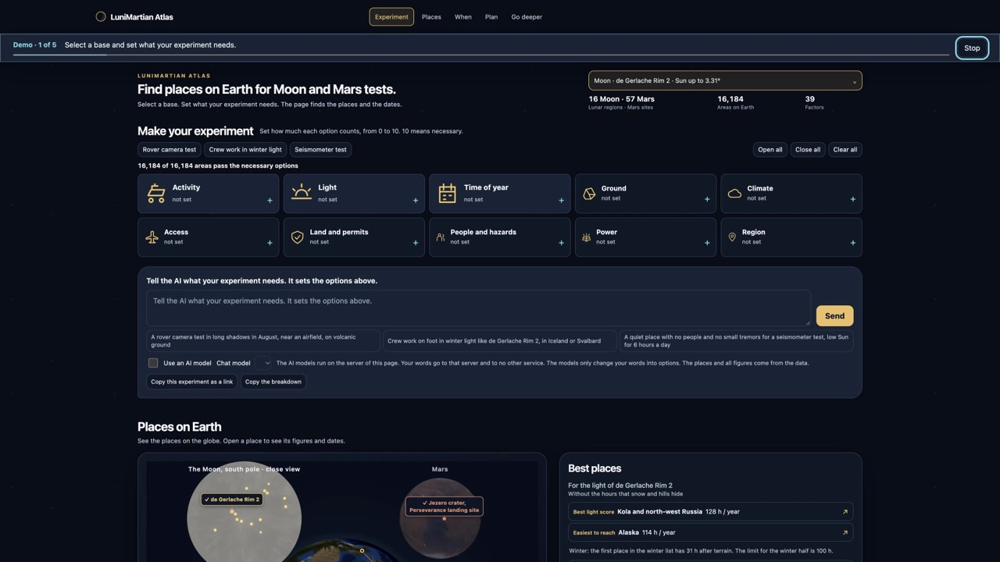

# Earth Twin Finder

**Open the page: http://15.204.81.56/**

**See the demo of 30 seconds: http://15.204.81.56/demo/earth-twin-finder-demo.mp4**

Earth Twin Finder finds places on Earth for tests of Moon and Mars work.
A scientist selects a candidate lunar landing region or a Mars site, and sets how much each condition counts, from 0 to 10.
The page then shows the areas on Earth that match best, with a match percent, the dates and the evidence.

*The experiment board of the page. Drawn by code from open data; the code was written with AI assistance.*

Behind the board is a measured map and calendar. It shows where and when Earth has the low Sun of the Moon's south pole.
It covers all 16 candidate landing regions of NASA's lists of 2022 and 2024, and approximately 16,000 areas of polar land. Each area is approximately 11 km wide.
It counts spells of low Sun of two hours or more on snow-free bare ground. It removes the hours that real hills hide, and it shows the effect of typical cloud.
It also tells clearly what no place on Earth can copy: black shadows, a slow Sun, vacuum, low gravity, dust and cold.
A coarser first pass does a similar search for 57 Mars sites.

It is an entry to the NASA Space Apps Challenge 2026. The challenge: [Identify Earth Locations that Analog the Permanent Moon Base Locations and Mars](https://www.spaceappschallenge.org/2026/challenges/permanent-moon-base-locations-and-mars/).

- The page: http://15.204.81.56/
- The repository: https://github.com/1004genre/nasalunarbase-26
- How the method works: [docs/METHOD.md](docs/METHOD.md)
- The results of the 16 lunar regions and the 57 Mars sites: [data/derived/RESULTS-FINAL.md](data/derived/RESULTS-FINAL.md)
- Each Moon result of the first build, with the file and field that it comes from: [data/derived/RESULTS.md](data/derived/RESULTS.md)
- The Mars first pass, site by site: [data/derived/MARS-RESULTS.md](data/derived/MARS-RESULTS.md)

## Why a map of low Sun

NASA and others rehearse under south-pole light with a lamp at night, or in halls with lamps. Their built test fields are approximately 77 m² to 1 hectare.
A natural site adds kilometres of real ground under parallel sunlight. But it does not have the black shadows of the Moon.
Sources: [NASA D-RATS 2022 report](https://ntrs.nasa.gov/api/citations/20230017073/downloads/D-RATS%202022%20Test%20Report%20Final.pdf), [DLR and ESA LUNA hall](https://www.dlr.de/en/latest/news/2024/training-facility-for-astronautical-and-robotic-missions-to-the-moon), [LunaLab, Luxembourg](https://orbilu.uni.lu/bitstream/10993/45539/1/IAC-20%2cA3%2c2B%2c3%2cx60946.pdf), [NASA Kennedy test bed](https://ntrs.nasa.gov/citations/20250000128), [Astrobotic field](https://www.astrobotic.com/astrobotic-unveils-terrestrial-moonscape-for-payload-testing/).

## The 16 lunar regions

We use all candidate landing regions of NASA's two lists for Artemis III. The list of 19 August 2022 has 13 regions, and the list of 28 October 2024 has nine. The lists share six regions, thus there are 16. NASA studied these regions as candidates. They are candidate regions, not landing sites.

| Lunar region | NASA lists | NASA 5 m terrain model | The centre of the Sun is never above |
|---|---|---|---|
| Connecting Ridge | 2022 only | Site01 | 2.08° |
| Connecting Ridge Extension | 2022 only | SL3 | 2.51° |
| Peak Near Shackleton | 2022 only | Site07 | 2.73° |
| de Gerlache Rim 1 | 2022 only | Site11 | 2.86° |
| de Gerlache Rim 2 | 2022 and 2024 | SL2 | 3.31° |
| Faustini Rim A | 2022 only | LM7 | 3.65° |
| Slater Plain | 2024 only | none | 4.38° |
| Haworth | 2022 and 2024 | Haworth | 4.78° |
| Malapert Massif | 2022 and 2024 | Site23 | 5.55° |
| de Gerlache-Kocher Massif | 2022 only | Site42 | 5.71° |
| Nobile Rim 1 | 2022 and 2024 | Site06 | 6.10° |
| Mons Mouton | 2022 and 2024 | Site20v2 | 6.11° |
| Mons Mouton Plateau | 2024 only | none | 7.21° |
| Amundsen Rim | 2022 only | DM1 | 7.31° |
| Nobile Rim 2 | 2022 and 2024 | DM2 | 7.59° |
| Peak near Cabeus B | 2024 only | none | 7.90° |

- We calculate each Sun ceiling from the latitude of the region and the tilt of the axis of the Moon. It is not a measurement.
- Three regions have no NASA 5 m terrain model: Slater Plain, Mons Mouton Plateau and Peak near Cabeus B. We placed them from NASA's map of 2024. Their hours are complete, because the hours need only the Sun ceiling. Their slopes, roughness and landform are unknown, and the page shows "unknown", not 0.
- NASA's map of 2024 has the box "Mons Mouton" at the place of the 2022 box "Leibnitz Beta Plateau". No NASA text uses the word "renamed". Mons Mouton Plateau is a different region.
- NASA sources tell that the Sun at the south pole is mostly near 2°.
- The names, lists and links are in `data/derived/moon_cards.json` and `data/reference/lunar_candidate_regions.json`.

## What we found on the Moon side

The words in this section. An **area** is a square of ground of approximately 11 km. A **spell** of low Sun is a continuous time with the Sun above the horizon and below the Sun ceiling of a region.
**Hours** are the hours in a year in spells of two hours or more. Two hours is our own rule.
The table of each region is in `data/derived/RESULTS-FINAL.md`. Malapert Massif, on both NASA lists, is the example below.

Three caveats apply to each figure of this section:

- **The hours after hills are a lower bound for 14 of the 16 regions.** The stored skylines have nine bins of Sun height. Most new Sun ceilings fall inside a bin, and a new bin takes the open share of the bin below it. Only Connecting Ridge and Connecting Ridge Extension use the full method of the first build, and that method is also an approximation.
- **Three regions have no terrain model** (see above). Their slope figures are unknown.
- **For four regions, a strip south of 59° north is outside the search.** For Mons Mouton Plateau, Amundsen Rim, Nobile Rim 2 and Peak near Cabeus B, spells of two hours start south of 59°. Our grid of areas starts at 59°.

1. **Long spells occur only at high latitudes.** Spells of two hours start at 64.80° for Connecting Ridge, the lowest Sun ceiling, and at 57.15° for Peak near Cabeus B, the highest.
   At the equator, the longest spell of the year is 10 to 37 minutes, by region.
   *Caveat: for Peak near Cabeus B, spells of one to two hours occur from approximately 44°. These latitudes are for a flat horizon and the standard refraction of light by the air.*
2. **In winter, almost no bare ground has this light without snow.** For Malapert Massif, approximately 14,000 measured northern areas get 100 winter hours from the geometry of the Sun alone. If we also count snow, 15 areas keep these hours, all in Iceland. If we also count hills, 12 keep them.
   For Peak near Cabeus B, the region with the highest Sun, 49 areas keep them after snow. Connecting Ridge has none.
   *Caveat: this is true for a limit of 100 hours, for spells of two hours, and for the snow maps as they are. With a limit of 50 hours, or with snow odds corrected to the weather stations, areas in Novaya Zemlya, Svalbard and Siberia also appear.*
   Small bare patches below our limit of 15 percent bare ground give more leads. For Peak near Cabeus B there are 83: Iceland 62, Norway 19, the Faroe Islands 1 and Novaya Zemlya 1. With hills, 30 stay. We do not count cloud there. They are leads to check, not results.
3. **Almost all usable hours are in the summer half of the year.** 98 to 99 percent of the hours on snow-free bare ground are between 1 April and 27 September, by region. The best three ten-day periods are between 30 July and 28 August.
   For slightly more than half of the hours, the Sun is in the northern half of the sky, from evening to morning.
   *Caveat: here, "usable" means over a flat horizon. If we also count typical cloud, the peak moves approximately ten days earlier, because August has more cloud than July.*
4. **The lowest Sun ceiling has almost no match on Earth.** For Connecting Ridge, 2 measured areas get 100 summer hours on snow-free ground over a flat horizon. A third area has 99 hours, thus the count can change easily.
   If we also count hills, no area gets 100 hours. The best area, in north-west Alaska (67.05 N, 158.85 W), keeps approximately 76 hours a year. Approximately 25 of these hours are under a typically clear sky.
   For Peak near Cabeus B, the best ranked area (75.35 N, 82.25 E, Siberia) keeps approximately 428 hours a year after snow and hills.
5. **Real hills hide many hours.** We counted all 14,833 northern areas with measured snow and a terrain horizon (`data/derived/RESULTS-FINAL.md` gives this filter and two others). By region, the median area keeps 29 to 58 percent of its hours. The lower the Sun ceiling, the smaller this share.
   A blind sample of 300 areas agrees within 3 percentage points.
   *Caveat: for 14 regions this share is a lower bound (see above). We have no horizons for 51 areas that lie across the 180° meridian.*
6. **In those months, cloud covers most of the sky.** Where the summer hours for Malapert Massif are, NASA's monthly mean sky cover is 73 percent in July and 78 percent in August.
   Approximately 23 percent of the hours are under a typically clear sky.
   *Caveat: typical cloud is a monthly mean for all of the day, for a box of 1 degree. It is not the cloud at the hours of low Sun.*
7. **The areas with the best light are remote, but some good areas are near airfields.** By light alone, the first place for 13 of the 16 regions is in the Russian Arctic. Kola and north-west Russia have 9 of them, and Siberia and the Russian Far East have 4. For the other 3, it is in Arctic Canada.
   These places look like bare, flat coasts. We did not check this on images.
   For Malapert Massif, approximately 320 ranked areas with 100 hours or more lie within 100 km of a runway with scheduled flights.
   *Caveat: the distances are straight lines to a runway. Volunteers mark the runway as one with scheduled flights. The distances tell nothing about roads, boats, permits or cost.*
8. **Known analog sites get scores in the middle of the range.** These sites are known for their geology, not for their light. By hours after hills, the median known or named northern site is better than 32 to 59 percent of ranked areas, by region.
   Haughton crater on Devon Island is better than 75 to 87 percent. In July 2001, a rover that follows the Sun had tests there (Hyperion, Carnegie Mellon, with funds from NASA).
   *Caveat: that rover used daylight of 24 hours. In July, Haughton has 0 to 63 hours in spells of two hours after hills. This is a simple check, not a test of the ranking.*
9. **Lower latitudes have the light, but only for short times.** We tested 11 places at lower latitudes, from Peru to Tibet. There, the Sun is never that low for two hours without a break. The longest spell is 65 minutes.

### Checks we did

These checks ran on 14 November 2026 for the four regions of the first build: Connecting Ridge, Malapert Massif, Mons Mouton and Nobile Rim 2. We did not run them again for the 16 regions. Their record is `data/derived/checks.json`.

- **Two counts.** A separate program, with no code in common with the pipeline, counted again the figures of hours of the 16,184 areas. No figure differs by more than our tolerance. The largest difference is 0.07 hour a year.
  *Caveat: it uses our terrain horizons and the same textbook formula for the Sun. Thus it checks the count, not these inputs.*
- **The Sun, compared with NASA JPL Horizons.** We compared 9 places, with 4 ten-day periods for each place. For all hours in each band, the median difference is 0.11 percent. The largest difference is 6.3 percent.
  For hours in spells of two hours or more, the median difference is 0.26 percent. The largest is 8 percent (1.6 hours in ten days). The 5 rows with a flag are all for Connecting Ridge.
- **From year to year.** We moved the calendar by 0.14 day. The hours of no area changed by more than our tolerance (at most 1.2 hours a year).
- **Snow maps, compared with weather stations.** At 139 stations, the odds of snow-free ground in the maps are, on average, lower than in the station records. Thus the maps tend to show too much snow.
- **The earlier regions after the passes.** The lunar passes of 15 November compared each earlier region with the files before the pass. The largest difference is 0.1 hour in rounded fields (`docs/all-regions-log.md`).

## What the page offers

The page is one static page in `site/`. It asks no other host for files.
There is one optional exception. If the visitor turns on the AI help of the text field, the page asks for an AI model server. On a local copy, that server is on the visitor's own computer (localhost, through Ollama). The public copy of the page asks its own server for the two models, at the address of the page.

- **The experiment board.** This is the first page. A researcher selects a base, then sets how much each option counts, from 0 to 10. A 10 means that the option is necessary.
  The options are in ten categories. Each category is closed at the start, and a click opens it. A switch sets each option that has only a yes or a no.
- **Describe the experiment in words.** A researcher writes in a text field, and the page sets the options. The page uses its own word rules first.
  Two AI models also help, but only if the visitor turns them on. An embedding model matches the words to the options. A small chat model reads the words that are left.
  The models never name a place and never give a figure. The field asks no question and gives no answer. The places and all figures come from the data.
- **The places in order of their match.** The places, in order of their match with the options, on three globes (the Moon, Mars and the Earth) and on flat polar maps.
- **"Which destination fits this experiment?"**
- **"Places like this one".** It shows the areas with the nearest figures to the open area. It compares the figures on the page. It does not measure how alike the ground is.
- **The calendar.** Ten-day periods, with the time of day. Four steps take away hours, one at a time: Sun only, snow-free ground, hills, typical cloud.
- **"Watch a day of low Sun".** For a place and a date, it shows the path of the Sun above the real hills, and the shadow of a 1 m rock.
- **The Planner.** For each rehearsal activity, each area gets "pass", "near" (nearly passes) or "does not pass". These verdicts come from our own rule, not from an agency standard.
- **Every factor.** A table of 39 factors. For each factor, it tells which of these groups it is in:
  - measured and used in the ranking
  - measured and only shown
  - a rough estimate by our own rule
  - figures for the lunar regions and the Mars sites only
  - not built.
- **Land status and permits.** A factor of the table. It tells who owns or governs the ground at the centre of an area, and whom to ask for a permit.
  It is a rough estimate by our own rule. It is not legal advice, and it tests only the centre of the area.
- **A tour of 60 seconds and a demo of 30 seconds.**

`site/README.md` lists the files of the page and its address keys.

The folder `analog-atlas-src/` holds an earlier front end of a team member. The page does not use it.

## Mars: a first pass

This part is a first pass. It is much coarser than the Moon part. It divides Earth into squares of half a degree, approximately 55 km wide. It scores 12,984 squares with at least 15 percent bare ground.

It compares them with 57 Mars sites. A site can be on more than one list:

- all nine NASA landing sites: Viking 1, Viking 2, Mars Pathfinder, Spirit, Opportunity, Phoenix, Curiosity (Gale), InSight and Perseverance (Jezero);
- the seven sites of the 2021 shortlist for human landings (Golombek and others, 2021, a study of Starship landing sites): PM-1, PM-7, AP-1, AP-8, AP-9, EM-15 and EM-16;
- the exploration zones that were proposed at NASA's 2015 workshop on human landing sites and that state a position: 39 sites of their own, and 8 zones at the place of a site that we use already;
- Arcadia Planitia and Deuteronilus Mensae, two regions that were studied for a human landing.

The workshop papers give 49 zones. We left out two: zone 1030 (south-western Meridiani Planum) and zone 1049 (Holden crater), because no usable position exists. A proposed zone is not a NASA decision. NASA did not name a human landing site on Mars.

It gives a separate score to five factors:

- terrain (slopes over approximately 3.7 km)
- dryness
- cold
- bare ground
- the range of the Sun height at noon.

Three goals combine them: landscape, environment, and all five factors together.

Two cautions apply to each Mars figure:

- **It is not a climate match.** The coldest ranked square has a yearly mean of −38.3 °C. Each Mars site is 15.1 to 56.4 °C colder. At the Mars sites, the air pressure is 0.47 to 0.88 percent of the pressure on Earth at sea level.
- **A score is not a share of likeness.** It is a position on the scale of each factor, between two set end points. For example, a cold score of 0.5 means a yearly mean halfway between +30 °C and the yearly mean of the Mars site.

The Mars Climate Database gave the model climate of the sites. At Gale and Phoenix, some values are measurements of the missions there.

What it found:

- By landscape alone, 1 to 1,102 squares share the top score, by Mars site. Thus a landscape list can show ten of many equal places. It is not a ranking.
- On all five factors, the first places of the 57 sites are on the Tibetan Plateau (35), in the Qaidam Basin (16), on the Altiplano and Puna (5) and in the Atacama Desert (1). Their scores are 0.59 to 0.77.
- Against all land, known Mars analog sites get a better landscape score than control squares in 78 to 83 percent of pairs. But bare ground alone gives 80 percent.
  Among bare squares only, the figure on all factors is 35 to 52 percent, and a random order gives 50 percent. Thus the scores do not find the known analog sites much better than a random order.

The slopes do not show rocks, dunes, small craters or other small features that a rover feels. The Earth climate is a model value for a grid box. We do not measure soil chemistry, minerals, ice or life.

## What Earth cannot copy

We match the height of the Sun, its direction and the length of the shadows. We match nothing else.

- **Contrast.** Our air puts light into the shadows and makes a low Sun less bright. On the Moon, the shadows are black. We have no number for this difference.
- **The slow Sun.** On the Moon, the Sun takes 29.53 days to go once around the horizon. On Earth, its direction moves approximately 26 to 29 times faster.
- **Vacuum, gravity, dust, radiation.** The Moon has no air, a gravity of 1.62 m/s² (one sixth of the gravity of Earth), sharp dry dust and no shield against radiation.
- **Cold.** At the 16 regions, models give a yearly mean of approximately −130 to −185 °C at 2 cm below the lunar surface.

The figures and their sources are in `data/derived/moon_cards.json`. For Mars, `data/derived/MARS-RESULTS.md`, section 6, gives a similar list.

## What is ours, and what is not

At least four other teams on this challenge show where and when the lunar light occurs. We do not say that we are the only team.
What we add for Earth:

- spells of two hours or more, counted for each day, for each ten-day period and by time of day;
- real hills, and the refraction of light by the air, applied to those hours;
- two checks: an independent recount, and a comparison with NASA JPL Horizons;
- snow from ten years of satellite maps, compared with weather stations;
- Antarctic rock outcrops, which the global land-cover map does not show;
- a list of bodies of anorthosite, the rock of the lunar highlands;
- a clear statement of what Earth cannot copy.

In the entries and archives that we had access to, none maps the Sun's height at these regions onto Earth with hills and snow counted.

## Open the page on your computer

The page is static. It has no build step, and it makes no request to another host (see the one exception in "What the page offers"). In the top folder of the project, run:

    python3 -m http.server 8800 --directory site

Then open http://localhost:8800 in a browser. `site/README.md` explains the files of the page and its address keys.

The repository: https://github.com/1004genre/nasalunarbase-26. The folder `deploy/` shows how the public copy of the page runs on a server.

## Rebuild everything

You must have Python 3.12 and [uv](https://docs.astral.sh/uv/). No download asks for an account or a login.

**What a new copy does not have.** Two sets of files are not in the repository, and some tests read them:

- 46 of the 71 files of `data/derived/` (approximately 1.2 GB on 15 November 2026; `cells_scored.json` is approximately 271 MB, `mars_cells.json` approximately 235 MB and `grazing_cells.json` approximately 160 MB). The repository holds only the 25 result files that `docs/PUBLIC-COPY.md`, section 4, names;
- the 36 saved JPL Horizons answers in `data/raw/horizons_check/` (7.8 MB). No project script gets them again.

The team did not publish these files yet. If you have them, put them at those paths. Then run:

    uv sync
    uv run pytest -q

Without them, these tests fail: `tests/test_check_against_horizons.py`, `test_winter_leads.py`, `test_export_site_tools.py` and `test_export_site_planner.py`.
A review on a copy without them also found failures of Mars tests, with no explanation. After that review, nobody ran the tests on a new copy.

**One command for the Moon part.** If the raw data are on the disk, this command makes the Moon results and the page data again, with no network:

    uv run python scripts/rebuild_all.py

On 14 November 2026, it took 38 minutes. `--list` prints its 18 steps. It downloads nothing.
It does not make the horizons, the land cover or the snow maps, the Mars part, the factor files or the two checks.
[docs/REPRODUCE.md](docs/REPRODUCE.md) gives each command, what each command downloads and its approximate size. The raw data on the disk now use approximately 12 GB.

## Data sources and credit

The sources of the Moon part. `data/SOURCES.md` lists each of them with its link, terms and credit line:

| Source | Provider | Used for | Licence or terms |
|---|---|---|---|
| LRO LOLA 5 m terrain models of south-pole sites (PGDA 78) | NASA Goddard | The 13 lunar regions with a model | Cite the paper |
| NASA's lists of 2022 and 2024 and NASA's map of the nine regions of 2024 | NASA | The names and lists of the 16 regions; the position of the three regions without a model | NASA material |
| LOLA polar illumination and shadow maps (PGDA 69) | NASA Goddard | Sunlight and permanent shadow at the regions | Cite the paper |
| JPL Horizons | NASA JPL | Check of Sun positions; Sun path at two regions | Cite |
| NASA POWER (CERES cloud, MERRA-2 temperature and snow) | NASA Langley | Typical cloud and temperature per area | Cite |
| LRO Diviner Polar Resource Product | NASA Planetary Data System | Model temperature and ice at the regions | Cite |
| Copernicus DEM GLO-90 | European Union and ESA | Hills and slopes of every area | Copernicus DEM licence, with notice |
| ESA WorldCover 10 m 2021 | ESA WorldCover consortium | Bare ground | CC BY 4.0 |
| IMS daily snow and ice maps, 4 km | U.S. National Ice Center, NSIDC | Odds of snow-free ground | Cite |
| GHCN-Daily | NOAA | Station check of the snow maps | Cite |
| Antarctic rock outcrop, two layers | British Antarctic Survey, SCAR | Bare rock in Antarctica | CC BY 4.0 |
| COMNAP Antarctic Facilities list | COMNAP | Nearest station to Antarctic sites | Educational and non-commercial use only |
| Open-Meteo (ERA5-Land, CERRA) | Open-Meteo, Copernicus Climate Change Service | Second opinion on snow | CC BY 4.0 |
| Natural Earth land outline | Natural Earth | The map's coastline | Public domain |
| OurAirports airports table | OurAirports | Distance to the nearest airfield | Public domain |
| Wikipedia and published papers | Wikipedia contributors and authors | The two reference lists | CC BY-SA 4.0 for the lists |

The Mars part and the new factors. `data/SOURCES.md` now lists these sources too, in section 1b. This table gives their terms as the `meta` block of each named file records them:

| Source | Used for | Terms as recorded |
|---|---|---|
| MGS MOLA MEGDR topography, NASA Planetary Data System | Mars slopes (`mars_terrain.json`) | NASA archive data; cite |
| NOAA NCEI ETOPO 2022, 60 arc-seconds | Earth slopes for the Mars part | Not recorded; check |
| Mars Climate Database v6.2 (LMD, with LATMOS, the Open University, IAA, ESA and CNES) | The model climate of the 57 Mars sites: yearly temperature and pressure | Scientific use if the origin is quoted and the authors are kept informed; no commercial use without permission |
| Curiosity weather feed (NASA) | Measured figures at Gale | NASA says it is for outreach, not archive data |
| NASA POWER, more parameters (precipitation, pressure, UV, sunlight, wind, albedo, soil wetness) | Mars-part climate; new factors | As for NASA POWER above |
| USGS ANSS Comprehensive Earthquake Catalog (ComCat) | Large earthquakes; small tremors | Public domain |
| Smithsonian Global Volcanism Program, volcano and eruption lists | Volcanoes; steady volcanic influence; geothermal class | Smithsonian terms of use: non-commercial use, with the citation and a link |
| GeoNames cities1000 | Nearest settlement; people nearby | CC BY 4.0 |
| Global Lithological Map (GLiM), Hartmann and Moosdorf 2012 | Rock type | CC BY 3.0 |
| Northern Hemisphere permafrost map, Obu and others 2019 (ESA GlobPermafrost) | Permafrost | CC BY 3.0 |
| Natural Earth roads and railways, 1:10m | Steady human influence | Public domain |
| WRI Global Power Plant Database 1.3.0 | Geothermal plants | CC BY 4.0 |
| NASA PDS, USGS Astrogeology and NASA pages; published papers | Figures for the lunar regions and Mars sites (`planet_factors.json`) | As listed in that file |
| NASA NSSDCA and PDS pages; the abstracts of NASA's 2015 workshop and NASA's map of the proposed zones; Golombek and others 2021 | The positions and names of the 57 Mars sites (`data/SOURCES.md`, rows 57 to 60) | The abstracts are (c) their authors: we take only names, positions and one sentence of our own words |

The sources of the globes and of the land status factor are in `data/SOURCES.md`, rows 42 to 56:

- The globe library is globe.gl 2.46.2, with three.js (MIT licence for both).
- The globe pictures:
  - the Earth: Blue Marble: Next Generation (NASA Earth Observatory)
  - the Moon: the CGI Moon Kit (NASA's Scientific Visualization Studio)
  - Mars: the Mars Viking Colorized Global Mosaic (MDIM 2.1; USGS Astrogeology Science Center and NASA Ames).
- The land status factor uses Natural Earth borders and official pages of each territory. It also uses maps of protected areas and land owners for Antarctica, Canada, Iceland, Norway, Sweden and Alaska.

The exact credit lines that the providers ask for follow, as `data/SOURCES.md` gives them. `NOTICE` has the same credits, some in a shorter form. We print them as the providers wrote them, thus some are long.

Credit lines, word for word

<!-- CREDITS-START -->
- **A. LOLA 5 m terrain (PGDA 78):** Barker, M.K., et al. (2021), Improved LOLA Elevation Maps for South Pole
  Landing Sites: Error Estimates and Their Impact on Illumination Conditions, Planetary & Space Science,
  Volume 203, 105119, doi:10.1016/j.pss.2020.105119. Data: NASA Goddard Planetary Geodesy Data Archive,
  https://pgda.gsfc.nasa.gov/products/78
- **B. LOLA illumination maps (PGDA 69):** Mazarico, E., et al. (2011), Illumination conditions of the lunar
  polar regions using LOLA topography, Icarus, Volume 211, Issue 2, 1066-1081, doi:10.1016/j.icarus.2010.10.030.
- **C. JPL Horizons:** NASA/JPL Solar System Dynamics. Data retrieved on 2026, November, 14. Horizons System.
  https://ssd.jpl.nasa.gov (the two lunar Sun tables were fetched on 15 November 2026 at 00:01 UTC, which is
  14 November in the Pacific time zone; the retrieval day of the reference values in `tests/test_sun.py` is
  not recorded in the code).
- **D. NASA POWER:** The data was obtained from National Aeronautics and Space Administration (NASA) Langley
  Research Center's Prediction Of Worldwide Energy Resources (POWER) project funded through the NASA Earth
  Science Division. The data was obtained from the POWER Project's Climatology and Daily 2.10.1 version on
  2026/11/14. (Cloud amount: CERES SYN1deg. Temperature and snow: MERRA-2.) The temperature requests ran
  from 23:55 UTC on 14 November to 00:04 UTC on 15 November 2026.
- **E. Copernicus DEM GLO-90.** Beside anything we computed from it (horizons, slopes, the map):
  "produced using Copernicus WorldDEM-90 © DLR e.V. 2010-2014 and © Airbus Defence and Space GmbH 2014-2018
  provided under COPERNICUS by the European Union and ESA; all rights reserved".
  If the tiles themselves were ever shared: "© DLR e.V. 2010-2014 and © Airbus Defence and Space GmbH
  2014-2018 provided under COPERNICUS by the European Union and ESA; all rights reserved". The licence (Article 6 c) also
  prescribes this sentence in any notice that covers sharing the data, changed or not: "The organisations in
  charge of the Copernicus programme by law or by delegation do not incur any liability for any use of the
  Copernicus WorldDEM-90". And (Article 6 d) we must not give the impression that our work is endorsed by them.
- **F. ESA WorldCover:** © ESA WorldCover project 2021 / Contains modified Copernicus Sentinel data (2021)
  processed by ESA WorldCover consortium. Citation: Zanaga, D., Van De Kerchove, R., Daems, D., De Keersmaecker,
  W., Brockmann, C., Kirches, G., Wevers, J., Cartus, O., Santoro, M., Fritz, S., Lesiv, M., Herold, M.,
  Tsendbazar, N.E., Xu, P., Ramoino, F., Arino, O., 2022. ESA WorldCover 10 m 2021 v200.
  https://doi.org/10.5281/zenodo.7254221 (CC BY 4.0).
- **G. IMS snow maps:** U.S. National Ice Center. (2008). IMS Daily Northern Hemisphere Snow and Ice Analysis
  at 1 km, 4 km, and 24 km Resolutions. (G02156, Version 1). [Data Set]. Boulder, Colorado USA. National Snow
  and Ice Data Center. https://doi.org/10.7265/N52R3PMC. 4 km GeoTIFF maps, every fifth day, 1 October 2015 to
  28 September 2025 (740 maps). Date Accessed 11-14-2026.
- **H. GHCN-Daily:** Menne, M.J., I. Durre, B. Korzeniewski, S. McNeill, K. Thomas, X. Yin, S. Anthony, R. Ray,
  R.S. Vose, B.E. Gleason, and T.G. Houston, 2012: Global Historical Climatology Network - Daily (GHCN-Daily),
  Version 3. NOAA National Climatic Data Center. http://doi.org/10.7289/V5D21VHZ [14 November 2026]. And:
  Menne, M.J., I. Durre, R.S. Vose, B.E. Gleason, and T.G. Houston, 2012: An overview of the Global Historical
  Climatology Network-Daily Database. Journal of Atmospheric and Oceanic Technology, 29, 897-910,
  doi:10.1175/JTECH-D-11-00103.1.
- **I. Open-Meteo:** "Weather data by Open-Meteo.com" as a link to https://open-meteo.com/ , licence CC BY 4.0
  (https://creativecommons.org/licenses/by/4.0/). Add: "Contains modified Copernicus Climate Change Service
  information 2026 (ERA5-Land, CERRA)". The second sentence is the usual Copernicus wording; the Copernicus
  licence itself was not opened today.
- **J. Antarctic rock outcrop, Landsat:** Gerrish, L. (2020). Automatically extracted rock outcrop dataset for
  Antarctica (Version 7.3) [Data set]. UK Polar Data Centre, Natural Environment Research Council, UK Research
  & Innovation. https://doi.org/10.5285/178EC50D-1FFB-42A4-A4A3-1145419DA2BB (CC BY 4.0). Method:
  Burton-Johnson, A., et al. (2016), The Cryosphere, 10, 1665-1677, doi:10.5194/tc-10-1665-2016.
- **K. Antarctic rock outcrop, medium resolution:** Skachkova, A., Gerrish, L., Fretwell, P., & Cooper, P. (2025).
  Medium resolution vector polygons of Antarctic rock outcrop - VERSION 7.11 (Version 7.11) [Data set]. NERC EDS
  UK Polar Data Centre. https://doi.org/10.5285/3f0c400f-04b9-4819-98cb-f6b53716aca5 (CC BY 4.0).
- **L. COMNAP:** Station names, status and distances: COMNAP Antarctic Facilities list, version 3.2.0
  (COMNAP 2019), copyright COMNAP, used here for educational and non-commercial purposes only.
- **M. Natural Earth (optional):** Made with Natural Earth. Free vector and raster map data @ naturalearthdata.com.
- **O. Diviner (lunar temperature and ice):** Paige et al., LRO DLRE LEVEL 5 PRP V2.0, NASA Planetary Data
  System, LRO-L-DLRE-5-PRP-V2.0, 2018. Model values, not measurements.
- **P. LROC (links to lunar mosaics):** NASA/GSFC/Arizona State University.
- **N. Wikipedia:** Site names and coordinates in the known-site list come in part from Wikipedia
  (https://en.wikipedia.org/wiki/Terrestrial_analogue_site and the pages linked in each entry), by Wikipedia
  contributors, CC BY-SA 4.0 (https://creativecommons.org/licenses/by-sa/4.0/). The list is shared under the
  same licence.
- **Q. OurAirports (distance to airfields):** Airfield data from OurAirports (https://ourairports.com/),
  public domain (The Unlicense), https://github.com/davidmegginson/ourairports-data . `airports.csv`
  downloaded on 15 November 2026 at 01:54 UTC (14 November in the Pacific time zone; server date of the
  file 14 November 2026, 02:54 GMT; sha256 5b3b48a4...574e8b). No credit is required; we give it anyway.
- **R. MOLA MEGDR (Mars heights):** Smith, D. E., et al., Mars Global Surveyor Laser Altimeter Mission Experiment
  Gridded Data Record, MGS-M-MOLA-5-MEGDR-L3-V1.0, NASA Planetary Data System.
- **S. ETOPO 2022 (Earth heights for the Mars part):** NOAA National Centers for Environmental Information. 2022:
  ETOPO 2022 15 Arc-Second Global Relief Model. NOAA National Centers for Environmental Information. DOI:
  10.25921/fd45-gt74 . Accessed 14 November 2026. (NCEI asks for this one citation for every ETOPO 2022 resolution;
  we used the 60 arc-second surface file.)
- **T. NASA POWER (Mars climate, factors, power):** The data was obtained from National Aeronautics and Space
  Administration (NASA) Langley Research Center's Prediction Of Worldwide Energy Resources (POWER) project funded
  through the NASA Earth Science Division. The data was obtained from the POWER Project's Climatology API v2.10.1 on
  2026/11/15. (Daily temperature range, top-soil wetness and 10 m wind speed: MERRA-2. Surface albedo: CERES SYN1deg.)
  The date is in UTC. The same wording covers the climate, sunlight, UV, haze and 50 m wind parameters of row 25;
  their sources are MERRA-2 and CERES SYN1deg as the row says. `power_cells.json` and `mars_power.json` carry an
  older POWER wording ("... (LaRC) Prediction of Worldwide Energy Resource (POWER) Project funded through the NASA
  Earth Science/Applied Science Program"); the referencing page today gives the wording above.
- **U. Mars Climate Database:** Mars Climate Database (c) LMD/LATMOS/OU/IAA/ESA/CNES. Version 6.2, web interface,
  climatology average solar scenario, read 14 November 2026 (Pacific time). Scientific, non-commercial use; the origin
  is quoted as the MCD terms ask. (These are the words of the MCD credit page; the page prints the same names.)
- **V. Phoenix MET:** Dickinson, C.D., PHX METEOROLOGICAL DATA V1.0, NASA Planetary Data System, 2008. (The citation
  the PDS Atmospheres Node gives for the data set.)
- **W. Curiosity REMS:** "Curiosity's weather figures are from NASA's public weather feed, which says it is for
  outreach; they are not archive data." Feed: NASA/JPL-Caltech, REMS by Centro de Astrobiología (CAB).
- **X. Planet-side maps:** NASA Planetary Data System, Geosciences Node (Washington University in St. Louis), with the
  instrument teams named per factor (MGS TES thermal inertia, Putzig and Mellon 2007; Mars Odyssey GRS; Lunar
  Prospector neutron spectrometer, Feldman et al. 2001). TES albedo: Christensen, P., et al. (2001), MGS TES;
  originator Arizona State University; publisher USGS Astrogeology Science Center.
- **Y. GLiM (rock type):** Rock type: GLiM, Hartmann & Moosdorf (2012), PANGAEA, CC BY 3.0. Full citation: Hartmann,
  Jens; Moosdorf, Nils (2012): Global Lithological Map Database v1.0 (gridded to 0.5 deg spatial resolution)
  [dataset]. PANGAEA, https://doi.org/10.1594/PANGAEA.788537. Supplement to: Hartmann, J.; Moosdorf, N. (2012): The
  new global lithological map database GLiM: A representation of rock properties at the Earth surface. Geochemistry,
  Geophysics, Geosystems 13, Q12004, https://doi.org/10.1029/2012GC004370. Licence:
  https://creativecommons.org/licenses/by/3.0/
- **Z. Permafrost map:** Permafrost: Obu et al. (2019), ESA GlobPermafrost, PANGAEA, CC BY 3.0. Full citation: Obu,
  Jaroslav; Westermann, Sebastian; Kääb, Andreas; Bartsch, Annett (2018): Ground Temperature Map, 2000-2016, Northern
  Hemisphere Permafrost [dataset]. Alfred Wegener Institute, Helmholtz Centre for Polar and Marine Research,
  Bremerhaven, PANGAEA, https://doi.org/10.1594/PANGAEA.888600. Method: Obu, J. et al. (2019): Northern Hemisphere
  permafrost map based on TTOP modelling for 2000-2016 at 1 km2 scale. Earth-Science Reviews 193, 299-316,
  https://doi.org/10.1016/j.earscirev.2019.04.023. Licence: https://creativecommons.org/licenses/by/3.0/
- **AA. USGS earthquakes:** Credit: U.S. Geological Survey. Data: USGS ANSS Comprehensive Earthquake Catalog
  (ComCat), https://earthquake.usgs.gov/fdsnws/event/1/ , read 14 November 2026 (Pacific time).
- **AB. Smithsonian volcanoes:** Global Volcanism Program, 2026. [Database] Volcanoes of the World (v. 5.4.0; 7 Aug
  2026). Distributed by Smithsonian Institution, compiled by Venzke, E. https://doi.org/10.5479/si.GVP.VOTW5-2026.5.4
  (the "General Database Citation" on the GVP pages saved the same night). `hazards_people_cells.json` still says the
  version is "to be filled in"; it is the version above. The terms of use are in row 38.
- **AC. GeoNames:** GeoNames (geonames.org), CC BY 4.0 (https://creativecommons.org/licenses/by/4.0/).
  `cities1000.zip` read 14 November 2026 (Pacific time).
- **AD. Global Power Plant Database:** Global Energy Observatory, Google, KTH Royal Institute of Technology in
  Stockholm, Enipedia, World Resources Institute. 2021. Global Power Plant Database version 1.3.0. Accessed through
  https://datasets.wri.org/datasets/global-power-plant-database on 14 November 2026. Licence CC BY 4.0. (This is WRI's
  wording on its dataset page. Our copy came from the GitHub repository wri/global-power-plant-database.
  `power_cells.json` and the page print an older wording that ends "Published on Resource Watch and Google Earth
  Engine".)
- **AE. Blue Marble (Earth globe):** NASA Earth Observatory. (Blue Marble: Next Generation, July 2004, with
  topography and bathymetry; fetched 15 November 2026.)
- **AF. CGI Moon Kit (Moon globe):** NASA's Scientific Visualization Studio. (CGI Moon Kit,
  https://svs.gsfc.nasa.gov/4720/ ; colour from the LROC Wide Angle Camera mosaic; fetched 15 November 2026.)
- **AG. Viking colour mosaic (Mars globe):** Mars Viking Colorized Global Mosaic (MDIM 2.1): USGS Astrogeology
  Science Center and NASA Ames; Viking Orbiter images, NASA. (Our wording; the product page asks for no credit line.
  Fetched 15 November 2026.)
- **AH. globe.gl and three.js (the globes):** globe.gl 2.46.2, https://github.com/vasturiano/globe.gl , MIT License.
  It bundles three.js, https://github.com/mrdoob/three.js , MIT License, Copyright © 2010-2026 three.js authors.
- **AI. Natural Earth boundaries (land status, optional):** Made with Natural Earth. Free vector and raster map data @ naturalearthdata.com.
- **AJ. Territory rules (land status):** Our own short statements from official pages of the Secretariat of the Antarctic
  Treaty, the Australian Antarctic Division, Crown-Indigenous Relations and Northern Affairs Canada, the Nunavut Research
  Institute, the Government of the Northwest Territories, Sysselmesteren på Svalbard, the U.S. Bureau of Land Management
  and Stjórnarráð Íslands, read on 15 November 2026. Not legal advice.
- **AK. Antarctic protected areas (land status):** Source: Antarctic Treaty Secretariat, ASMA and ASPA shapefile
  (2024 version), https://www.ats.aq/e/protected.html , CC BY 4.0. Converted to WGS 84 and cut to the areas of
  this project. (Our wording; the Secretariat asks only that the source is given. Fetched 15 November 2026.)
- **AL. Canadian maps (land status):** Contains information licensed under the Open Government Licence – Canada.
  (Canadian Protected and Conserved Areas Database, Environment and Climate Change Canada; Aboriginal Lands of
  Canada Legislative Boundaries, Natural Resources Canada; fetched 15 November 2026.)
- **AM. Iceland protected areas (land status):** Friðlýst svæði á Íslandi, Umhverfis- og orkustofnun. (Fetched
  15 November 2026; the provider asks that the source is cited.)
- **AN. Norway protected areas (land status):** Som referanse til kartet oppgis Miljødirektoratet. (Naturvernområder,
  NLOD 2.0; fetched 15 November 2026.)
- **AO. Sweden protected areas (land status):** Källa: Naturvårdsverket. (Skyddade områden, Naturvårdsregistret,
  CC0; fetched 15 November 2026.)
- **AP. PAD-US (land status):** U.S. Geological Survey (USGS) Gap Analysis Project (GAP), 2024, Protected Areas
  Database of the United States (PAD-US) 4.1: U.S. Geological Survey data release, https://doi.org/10.5066/P96WBCHS.
- **AQ. BLM Alaska (land status):** Bureau of Land Management, Alaska. BLM AK Administered Lands (SMA), data of
  31 August 2026. Our changes: we kept only the polygons that hold an area centre, the BLM server simplified the
  outlines by approximately 55 m, and we added the property agency_unit. (Fetched 15 November 2026.)
- **AR. Territory and entry rules, regional pass (land status):** Our own short statements from official pages of
  the Secretariat of the Antarctic Treaty, Crown-Indigenous Relations and Northern Affairs Canada, Avannaata
  Kommunia, the Expedition Office of the Government of Greenland, Stjórnarráð Íslands, Náttúruverndarstofnun,
  Lovdata, Sysselmesteren på Svalbard, Finnmarkseiendommen, Statskog, Sveriges riksdag, Naturvårdsverket, the
  President of Russia, the U.S. Bureau of Land Management, the National Park Service, the U.S. Fish and Wildlife
  Service, the Alaska Department of Natural Resources, Ahtna, Eklutna and Cook Inlet Region, read on
  15 November 2026. Not legal advice.
- **AS. The seven Mars sites added on 15 November 2026 (positions and short facts):** NASA Space Science Data
  Coordinated Archive (NSSDCA), spacecraft pages of Viking 1 Lander, Viking 2 Lander, Mars Pathfinder, Spirit,
  Opportunity and InSight, https://nssdc.gsfc.nasa.gov/ ; PDS Geosciences Node, Analyst's Notebook, MER mission
  overview; Golombek, M., et al. (2020), Geology of the InSight landing site on Mars, Nature Communications 11, 1014,
  doi:10.1038/s41467-020-14679-1 (CC BY 4.0); Golombek, M., et al. (2021), SpaceX Starship landing sites on Mars,
  52nd Lunar and Planetary Science Conference, abstract 2420 (LPI Contrib. No. 2548); USGS Gazetteer of Planetary
  Nomenclature, Phlegra Montes. (Fetched 15 November 2026.)
- **AT. The exploration zones of 2015 (positions and names):** Abstracts of the First Landing Site/Exploration Zone
  Workshop for Human Missions to the Surface of Mars, Lunar and Planetary Institute, Houston, 27-30 October 2015,
  https://www.hou.usra.edu/meetings/explorationzone2015/ ; (c) their authors, published by the Lunar and Planetary
  Institute. Only names, positions and one sentence of our own words are taken. Abstracts 1031 and 1056 from NASA's
  compiled abstract set. (Fetched 15 November 2026.)
- **AU. NASA's map of the proposed zones:** NASA Mars Program Office, Potential Exploration Zones for Human Missions
  to the Surface of Mars, version 10 (PDF) and version 12 (16 October 2015). (Fetched 15 November 2026.)
- **AV. The 2021 shortlist for human landings:** Golombek, M., et al. (2021), SpaceX Starship landing sites on Mars,
  52nd Lunar and Planetary Science Conference, abstract 2420 (LPI Contrib. No. 2548), Table 1; (c) its authors,
  published by the Lunar and Planetary Institute. (Fetched 15 November 2026.)
- **AW. NASA's map of the nine lunar regions of 2024 (positions of three lunar regions):** NASA. (Map of the
  nine candidate landing regions for Artemis III, NASA release 24-136 of 28 October 2024; its background is a
  mosaic of LRO Wide Angle Camera images. Fetched 15 November 2026.)
- **AX. USGS grid release (the boxes of the 13 regions of 2022):** McClernan, M.T., 2024, Lunar Grid Reference
  System (LGRS) Artemis III Candidate Landing Site Navigational Grids in Artemis Condensed Coordinate (ACC)
  Format: U.S. Geological Survey data release, https://doi.org/10.5066/P13FD9ZD. (The citation of the ScienceBase
  record; CC0. Read 15 November 2026.)
<!-- CREDITS-END -->

`scripts/write_readme_credits.py` copies these lines from `data/SOURCES.md`, section 3. After a change to that file, run the script again.

## How AI was used

The Space Apps 2026 guides call AI tools "Super Intelligence (SI)". We used two.

An AI assistant (Claude, made by Anthropic, used through Claude Code) researched the challenge and earlier work, and proposed directions.
It wrote the pipeline code, did the calculations and wrote the first versions of these texts.
A second AI tool for code (OpenAI Codex) wrote most of the code of the web page from written task sheets.

The page itself can use two open AI models on the visitor's own computer, through Ollama, but only if the visitor turns them on. On the public copy of the page, the two models run on the server of the page.
The page uses them only to change the words of a researcher into options. They never name a place and never give a figure.

The team lead selected the challenge and the direction: the Moon first, then Mars.
The team lead decided which factors and which sites to add, and asked for the experiment board and its numbers from 0 to 10.
The team lead decides what we submit.

Code draws the charts and maps from open data. The globes show surface pictures from NASA and USGS. No image is AI-generated art.

## Limits

- **We match only the light.** See "What Earth cannot copy".
- **Two hours is our own rule.** A rule of one hour reaches much lower latitudes, and we did not search there. A rule of three hours moves each belt up to 1.5° nearer to the pole.
- **The hours after hills are a lower bound for 14 of the 16 regions.** The stored skylines have nine bins of Sun height. A new run of the horizon step at each Sun ceiling can increase these hours. It needs approximately 90 minutes of computer time, and we did not do it.
- **Three regions have no NASA terrain model:** Slater Plain, Mons Mouton Plateau and Peak near Cabeus B. Their slope figures are unknown.
- **For four regions, a strip south of 59° is outside the search:** Mons Mouton Plateau, Amundsen Rim, Nobile Rim 2 and Peak near Cabeus B. Their belts start at 58.25° to 57.15°.
- **We measure snow only north of the equator.** In Antarctica, we use the mapped rock outcrops, and we count only the rock season (27 November to 1 March).
  Station records show snow at 6 of the 15 named southern sites.
- **The snow data have pixels of 4 km.** A coastal area can have only a few of them. We do not use 36 areas, because their snow data are doubtful. 34 areas have no snow data.
- **The hills come from 90 m elevation data**, in 36 directions. The data can miss a narrow peak or gap. We have no horizons for 51 areas at the antimeridian.
- **The refraction of light uses a standard value.** Real polar air can bend light more or less than this value.
- **Typical cloud is a monthly climatology of a 1-degree box**, not the cloud at the hours of low Sun.
- **"Bare" is a satellite class.** It includes sand bars, tidal flats and gravel, and also rock.
- **The ranking is not a shortlist.** It does not use permits, protection or cost. The page shows the factor "Land status and permits", but this factor is not in the score.
- **Hours are approximate.** Read them as correct to approximately ±1 hour, not to the exact hour.
- **The checks ran for four regions.** The recount, the Horizons check and the calendar check ran for the four regions of the first build.
- **The Mars part is a first pass** on squares of approximately 55 km. It is not a climate match, and a score is not a share of likeness. The Mars Climate Database gave the model climate of the sites.
- **Two zones of 2015 are not in the Mars part:** zone 1030 and zone 1049. No usable position exists for them.
- **Rough estimates are ours.** Each factor with the mark "rough estimate" is a rough estimate by our own rule. It is not a measurement.

`data/derived/RESULTS-FINAL.md`, `RESULTS.md`, section (i), and `MARS-RESULTS.md`, section 9, give the full lists of what is doubtful or not included.

## Licence

Code: Apache License 2.0. Our result files: CC BY 4.0, except `data/reference/known_analogs.json` and `anorthosite_bodies.json` (CC BY-SA 4.0), the station fields taken from COMNAP, values from the Mars Climate Database, and volcano names, years and distances from the Smithsonian Global Volcanism Program (non-commercial use only, under each provider's terms). Source data keep their own licences, listed in data/SOURCES.md. Not a NASA product; no endorsement by NASA, ESA, the European Union, NOAA or any other provider is implied.

The licence line above is the one `data/SOURCES.md` gives.

Copyright 2026 the Earth Twin Finder team. See `LICENSE` and `NOTICE`.
